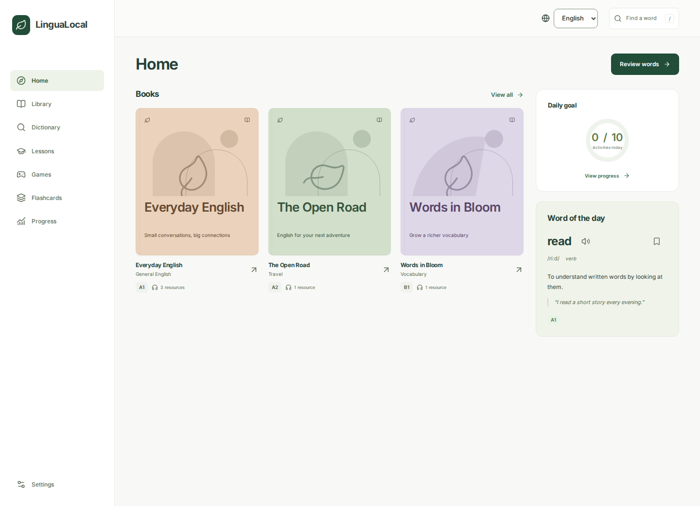
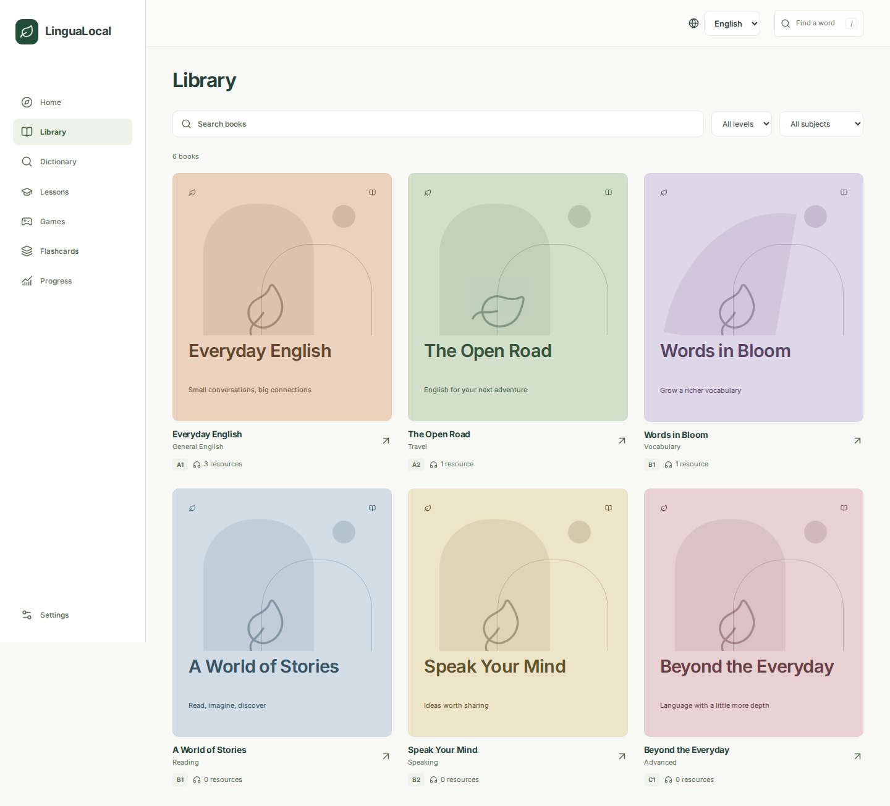
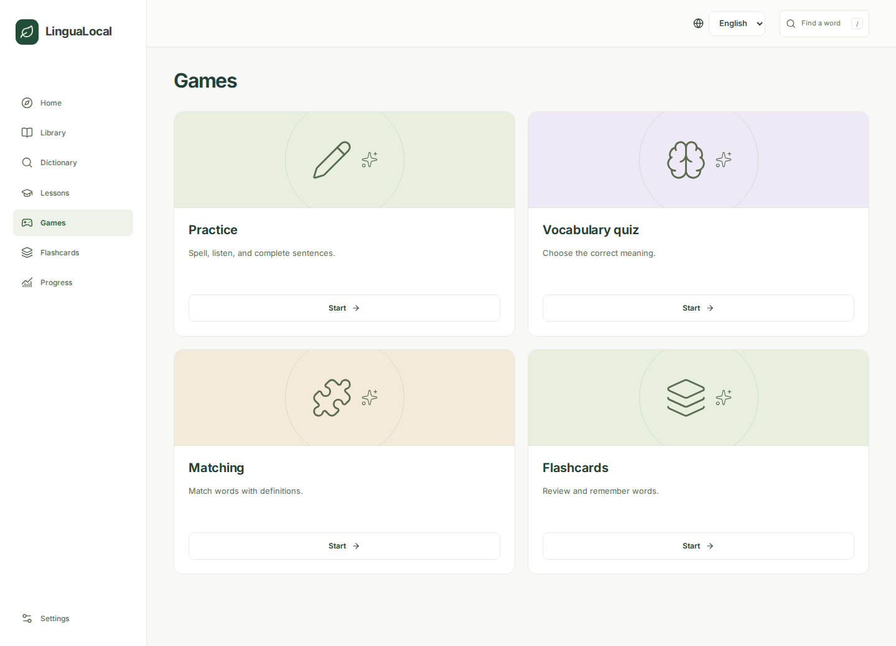

<div align="center">
  
  <h1>LinguaLocal</h1>
  <p><strong>Your school. Your resources. A world of possibilities.</strong></p>
  <p>A welcoming language learning hub that lives on your school’s local network.</p>
  <p>
    <a href="#quick-start">Get started</a> ·
    <a href="#feature-catalogue">Explore the features</a> ·
    <a href="docs/DEPLOYMENT.md">Deployment guide</a> ·
    <a href="docs/CONTENT.md">Bring your own content</a>
  </p>
  
  
  
  <a href="LICENSE"></a>
</div>

<br />



Give students a place to browse their books, listen to a conversation, discover a new word, and practise a little every day. Run LinguaLocal on one school computer and open it from any phone, tablet, or laptop on the same Wi-Fi network.

No accounts. English, Persian, Arabic, and Turkish interfaces. No subscriptions. No runtime cloud services. Fonts, artwork, starter lessons, and sample media are included.

## Why LinguaLocal

- **A learning space worth opening** with a calm bookshelf, thoughtful empty states, and layouts that fit phones and desktops.
- **One computer, a whole classroom** with local audio and video streaming that supports seeking and downloads.
- **Your curriculum belongs here** with portable packs for books, lessons, vocabulary, transcripts, and captions.
- **Practice that remembers** with saved words, spaced review, daily goals, streaks, and personal progress backups.
- **Easy to own** with a single Next.js service, portable JSON content packs, a persistent data directory, and Docker deployment.

## Feature catalogue

| Feature                        | What you can do                                                                                         | Preview                                                      |
| ------------------------------ | ------------------------------------------------------------------------------------------------------- | ------------------------------------------------------------ |
| Learning overview              | Open books, review vocabulary, and see your daily goal                                                  | [Overview](docs/screenshots/overview.png)                    |
| Book library                   | Search books and filter by subject or CEFR level                                                        | [Bookshelf](docs/screenshots/library.png)                    |
| Listening and watching         | Play local audio and video, change speed, repeat a passage, and jump through timed transcripts          | [Listening](docs/screenshots/listening.png)                  |
| Reading materials              | Open and download local PDF worksheets alongside book media                                             | [Book resources](docs/screenshots/book-everyday-english.png) |
| Offline dictionary             | Search curated meanings and synonyms, see examples, and bookmark words                                  | [Dictionary](docs/screenshots/dictionary.png)                |
| Guided lessons                 | Explore grammar, reading, vocabulary, and speaking with practice questions                              | [Lesson](docs/screenshots/lesson-present-simple.png)         |
| Vocabulary quiz                | Choose a level, discover meanings, get feedback, and save your score                                    | [Vocabulary quiz](docs/screenshots/quiz-playing.png)         |
| Matching game                  | Pair words and definitions without a timer or leaderboard                                               | [Matching](docs/screenshots/matching-playing.png)            |
| Spaced flashcards              | Study all words, saved words, or cards ready for review                                                 | [Flashcards](docs/screenshots/flashcards-playing.png)        |
| Written and listening practice | Spell words, complete sentences, and use a local English voice                                          | [Practice](docs/screenshots/practice-playing.png)            |
| Appearance                     | Choose light, dark, or your device setting alongside reading and quiet preferences                      | [Dark appearance](docs/screenshots/dark-overview.png)        |
| Owner content tools            | Import vocabulary spreadsheets, convert subtitles, diagnose files, and create portable server snapshots | [Content tools](docs/CONTENT.md)                             |
| Learning progress              | See an eight-week activity map, streaks, completed lessons, and recent results                          | [Progress](docs/screenshots/progress.png)                    |
| School network                 | Reveal a shareable school address and scan a local QR code                                              | [Join the school network](docs/screenshots/join-network.png) |
| Reading preferences            | Choose larger text, readable fonts, spacing, contrast, and quiet mode                                   | [Reading controls](docs/screenshots/reading-settings.png)    |
| Personal settings              | Export or restore progress backups                                                                      | [Settings](docs/screenshots/settings.png)                    |

<table>
  <tr>
    <td></td>
    <td></td>
  </tr>
  <tr>
    <td></td>
    <td></td>
  </tr>
</table>

Choose a language using the globe control on any page. Persian and Arabic mirror the interface. Dictionary entries, book text, and English exercises keep their original language and reading direction. The choice stays in this browser without an account.

| Interface | Desktop                                     | Mobile                                                       |
| --------- | ------------------------------------------- | ------------------------------------------------------------ |
| فارسی     | [Persian](docs/screenshots/fa-overview.png) | [Persian on mobile](docs/screenshots/fa-overview-mobile.png) |
| العربية   | [Arabic](docs/screenshots/ar-overview.png)  | [Arabic on mobile](docs/screenshots/ar-overview-mobile.png)  |
| Türkçe    | [Turkish](docs/screenshots/tr-overview.png) | [Turkish on mobile](docs/screenshots/tr-overview-mobile.png) |

[See the complete screenshot catalogue, including mobile pages](docs/FEATURES.md).

## Quick start

### Docker

```sh
git clone https://github.com/IlyaKhalafi/LinguaLocal.git
cd LinguaLocal
docker compose up --build -d
```

Open `http://localhost:3000` on the server. Students open `http://YOUR-SERVER-LAN-IP:3000` on the same network. For example, a server at `192.168.1.20` is available at `http://192.168.1.20:3000`.

School content and media stay in the `school-data` volume when the container is rebuilt.

### Node.js

Use Node.js 22.13 or newer. Node.js 26.11.1 is used in the Docker image and CI.

```sh
npm ci
npm run build
npm start
```

The production server listens on all network interfaces at port 3000. To use another port, run `npm start -- --port 8080`.

For development, run `npm run dev`.

## Bring your school’s books

1. Copy `src/content/starter.json` to a working content pack and edit it on the server.
2. Place audio, videos, PDFs, and WebVTT captions in `data/media`.
3. Set each book resource’s file path relative to that directory.
4. Validate and install the collection using the content guide.

Media files travel separately. The bundled collection contains six original book shells, six lessons, 90 dictionary words, a spoken listening sample, a short captioned video, and a PDF worksheet. Replace or expand it with material your school has permission to use.

[Read the content guide](docs/CONTENT.md) for the pack format, large files, and migration from the previous Python app.

## How it works

```text
School computer running LinguaLocal
                 |
          Local Wi-Fi router
                 |
      Student phones and laptops
```

The server stores the school’s shared content and streams its media. Each browser stores its own saved words, reviews, completed lessons, and game results. Students can export their progress and restore it on another device.

The app needs a running server and a connection to the school network. Internet access is needed to install dependencies or build the Docker image initially. Once installed, the learning hub works without internet access. Dictionary pronunciation uses an English voice installed locally on the student’s device when one is available.

There is deliberately no sign-in or access control. The public hub serves shared curriculum without browser editing. Owners manage content and school settings directly on the server. Shared computers share the progress saved in that browser.

## Development

```sh
npm run check
npm run build
npx playwright install --with-deps chromium webkit
npm run test:e2e
```

Unit tests cover review scheduling, quiz generation, content validation, corrupt-data recovery, and HTTP range parsing. Browser tests exercise every starter page, responsive navigation, accessibility, playback, read-only shared content, and persistent learning workflows. The offline checks block external requests.

Capture fresh desktop and mobile screenshots from a running production server with `SCREENSHOT_BASE_URL=http://127.0.0.1:3000 npm run screenshots`.

Direct dependencies were checked against their stable registry releases on 11 October 2026 and are pinned in the lockfile. TypeScript 7 is the compiler. The official TypeScript 6 compatibility package supplies the API needed by the current lint tooling.

[Architecture and verification](docs/ARCHITECTURE.md) · [Contributing](CONTRIBUTING.md) · [Previous Python app](https://github.com/IlyaKhalafi/LinguaLocal-Before)

## License

LinguaLocal is available under the [MIT license](LICENSE). Bundled [Inter](public/fonts/inter-license.txt), [Noto Sans Arabic](public/fonts/noto-arabic-license.txt), and [Atkinson Hyperlegible](public/fonts/atkinson-license.txt) retain their font licenses. Bring your own licensed classroom materials and make the learning space your own.
