# The feature and screenshot catalogue

Every starter page is captured on desktop and mobile. The examples use the original included collection.

| Page                              | Route                               | Desktop                                              | Mobile                                                      |
| --------------------------------- | ----------------------------------- | ---------------------------------------------------- | ----------------------------------------------------------- |
| Home                              | `/`                                 | [View](screenshots/overview.png)                     | [View](screenshots/overview-mobile.png)                     |
| Library                           | `/library`                          | [View](screenshots/library.png)                      | [View](screenshots/library-mobile.png)                      |
| Dictionary                        | `/dictionary`                       | [View](screenshots/dictionary.png)                   | [View](screenshots/dictionary-mobile.png)                   |
| Lessons                           | `/lessons`                          | [View](screenshots/lessons.png)                      | [View](screenshots/lessons-mobile.png)                      |
| Games                             | `/games`                            | [View](screenshots/games.png)                        | [View](screenshots/games-mobile.png)                        |
| Practice                          | `/games/practice`                   | [View](screenshots/practice.png)                     | [View](screenshots/practice-mobile.png)                     |
| Vocabulary quiz                   | `/games/quiz`                       | [View](screenshots/quiz.png)                         | [View](screenshots/quiz-mobile.png)                         |
| Matching                          | `/games/match`                      | [View](screenshots/matching.png)                     | [View](screenshots/matching-mobile.png)                     |
| Flashcards                        | `/flashcards`                       | [View](screenshots/flashcards.png)                   | [View](screenshots/flashcards-mobile.png)                   |
| Lesson vocabulary review          | `/flashcards?lesson=present-simple` | [View](screenshots/lesson-review.png)                | [View](screenshots/lesson-review-mobile.png)                |
| Progress                          | `/progress`                         | [View](screenshots/progress.png)                     | [View](screenshots/progress-mobile.png)                     |
| Settings                          | `/settings`                         | [View](screenshots/settings.png)                     | [View](screenshots/settings-mobile.png)                     |
| Everyday English                  | `/library/everyday-english`         | [View](screenshots/book-everyday-english.png)        | [View](screenshots/book-everyday-english-mobile.png)        |
| The Open Road                     | `/library/the-open-road`            | [View](screenshots/book-the-open-road.png)           | [View](screenshots/book-the-open-road-mobile.png)           |
| Words in Bloom                    | `/library/words-in-bloom`           | [View](screenshots/book-words-in-bloom.png)          | [View](screenshots/book-words-in-bloom-mobile.png)          |
| A World of Stories                | `/library/a-world-of-stories`       | [View](screenshots/book-a-world-of-stories.png)      | [View](screenshots/book-a-world-of-stories-mobile.png)      |
| Speak Your Mind                   | `/library/speak-your-mind`          | [View](screenshots/book-speak-your-mind.png)         | [View](screenshots/book-speak-your-mind-mobile.png)         |
| Beyond the Everyday               | `/library/beyond-the-everyday`      | [View](screenshots/book-beyond-the-everyday.png)     | [View](screenshots/book-beyond-the-everyday-mobile.png)     |
| The art of small talk             | `/lessons/small-talk`               | [View](screenshots/lesson-small-talk.png)            | [View](screenshots/lesson-small-talk-mobile.png)            |
| Everyday habits, simple sentences | `/lessons/present-simple`           | [View](screenshots/lesson-present-simple.png)        | [View](screenshots/lesson-present-simple-mobile.png)        |
| Your next stop                    | `/lessons/travel-phrases`           | [View](screenshots/lesson-travel-phrases.png)        | [View](screenshots/lesson-travel-phrases-mobile.png)        |
| Reading between the lines         | `/lessons/reading-between-lines`    | [View](screenshots/lesson-reading-between-lines.png) | [View](screenshots/lesson-reading-between-lines-mobile.png) |
| Make your point                   | `/lessons/giving-opinions`          | [View](screenshots/lesson-giving-opinions.png)       | [View](screenshots/lesson-giving-opinions-mobile.png)       |
| One word, many possibilities      | `/lessons/word-families`            | [View](screenshots/lesson-word-families.png)         | [View](screenshots/lesson-word-families-mobile.png)         |
| Ask a little more                 | `/lessons/asking-questions`         | [View](screenshots/lesson-asking-questions.png)      | [View](screenshots/lesson-asking-questions-mobile.png)      |
| Ordering a meal                   | `/lessons/ordering-food`            | [View](screenshots/lesson-ordering-food.png)         | [View](screenshots/lesson-ordering-food-mobile.png)         |
| Yesterday in a few words          | `/lessons/past-time`                | [View](screenshots/lesson-past-time.png)             | [View](screenshots/lesson-past-time-mobile.png)             |
| Plans for the weekend             | `/lessons/future-plans`             | [View](screenshots/lesson-future-plans.png)          | [View](screenshots/lesson-future-plans-mobile.png)          |
| Make your ideas flow              | `/lessons/linking-ideas`            | [View](screenshots/lesson-linking-ideas.png)         | [View](screenshots/lesson-linking-ideas-mobile.png)         |
| A clear request                   | `/lessons/email-request`            | [View](screenshots/lesson-email-request.png)         | [View](screenshots/lesson-email-request-mobile.png)         |
| An argument with support          | `/lessons/argument-structure`       | [View](screenshots/lesson-argument-structure.png)    | [View](screenshots/lesson-argument-structure-mobile.png)    |
| Leave room for uncertainty        | `/lessons/careful-claims`           | [View](screenshots/lesson-careful-claims.png)        | [View](screenshots/lesson-careful-claims-mobile.png)        |
| Choose the right register         | `/lessons/register-shift`           | [View](screenshots/lesson-register-shift.png)        | [View](screenshots/lesson-register-shift-mobile.png)        |
| Read a claim closely              | `/lessons/critical-claims`          | [View](screenshots/lesson-critical-claims.png)       | [View](screenshots/lesson-critical-claims-mobile.png)       |
| Page not found                    | `/not-a-page`                       | [View](screenshots/not-found.png)                    | [View](screenshots/not-found-mobile.png)                    |

## A little practice in action

### Vocabulary quiz

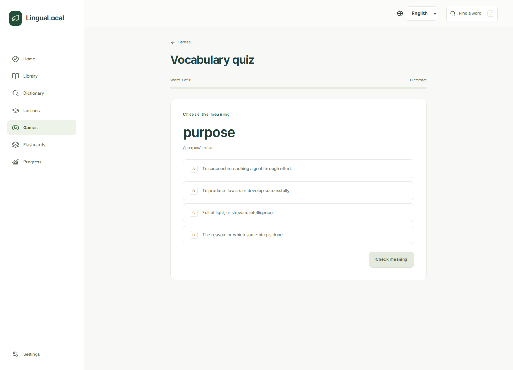

[Checked answer](screenshots/quiz-feedback.png) · [Mobile](screenshots/quiz-feedback-mobile.png)

### Matching

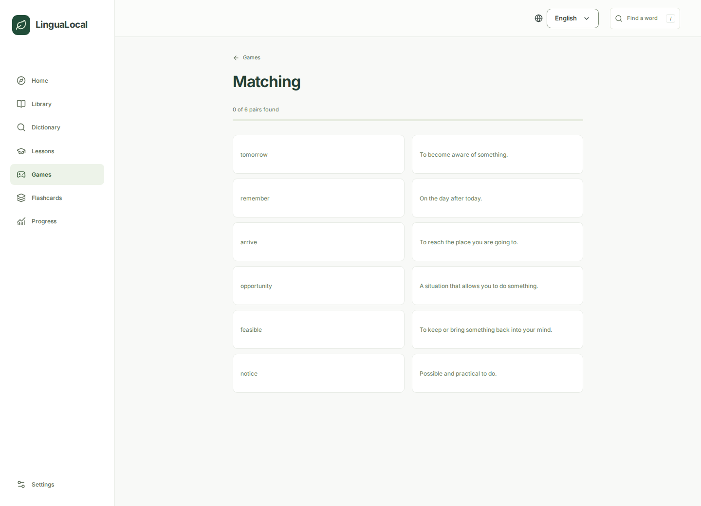

### Flashcards

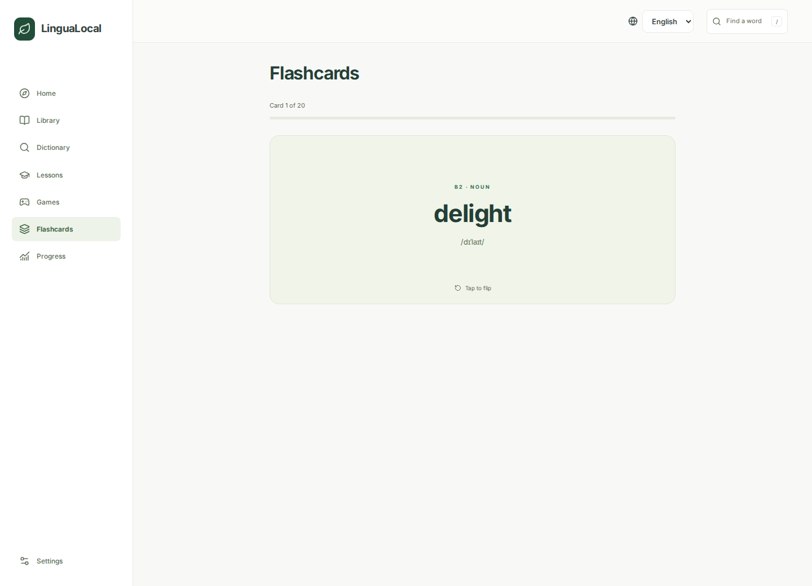

### Listening and transcripts

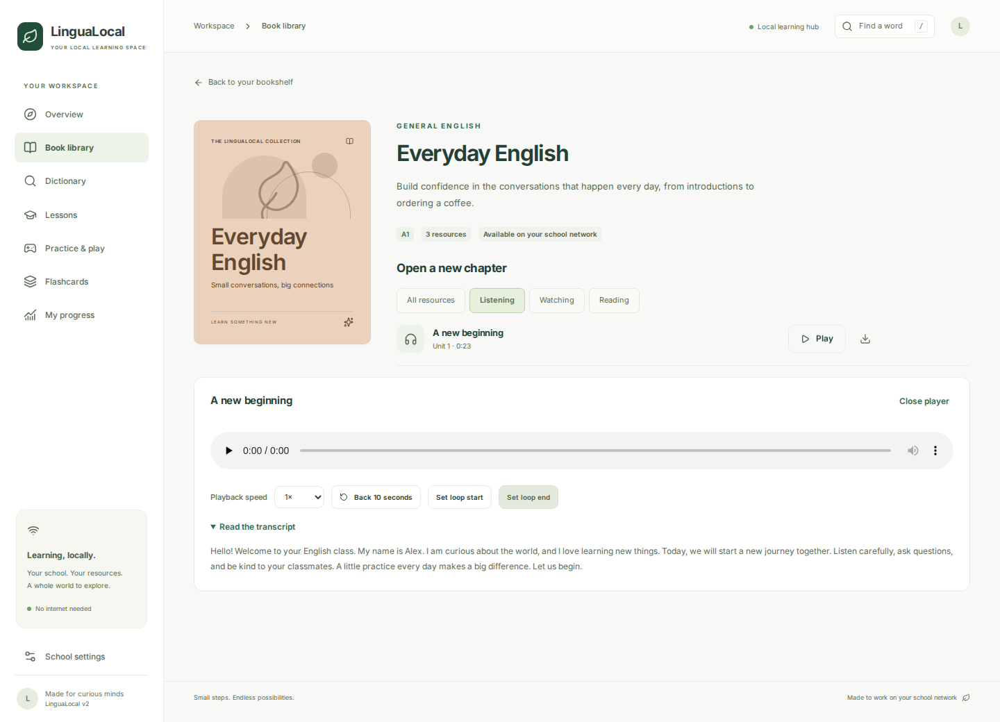

### Joining the school network

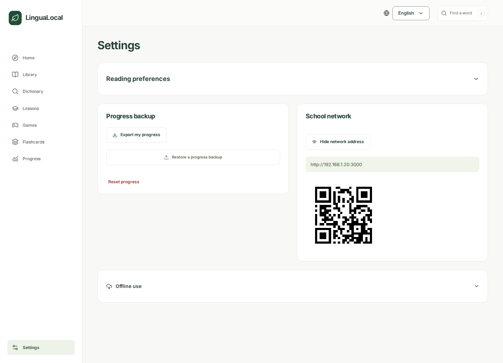

The address appears on request. Choose a network interface only when more than one is available.

## Reading preferences

Settings offers larger reading text, comfortable line spacing, a bundled Atkinson Hyperlegible font, higher contrast, and a quiet mode that removes decorative art and animations. These choices stay in the current browser. The controls remain collapsed until needed.

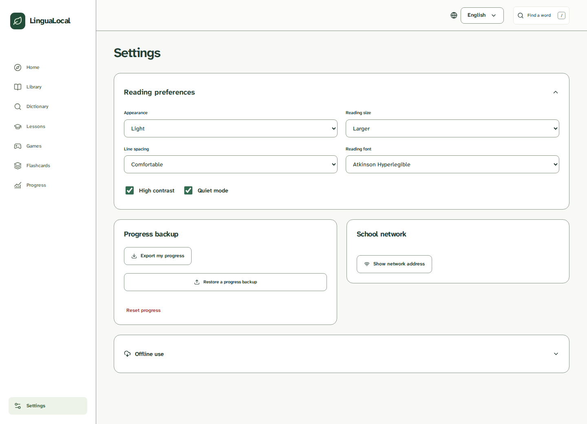

## Interface languages

The interface supports English, Persian, Arabic, and Turkish. Persian and Arabic use right-to-left navigation while English learning material stays left to right.

| Language | Home                                                                                  | Library                                                                             | Games                                                                           | Settings                                                                              |
| -------- | ------------------------------------------------------------------------------------- | ----------------------------------------------------------------------------------- | ------------------------------------------------------------------------------- | ------------------------------------------------------------------------------------- |
| Persian  | [Desktop](screenshots/fa-overview.png) · [Mobile](screenshots/fa-overview-mobile.png) | [Desktop](screenshots/fa-library.png) · [Mobile](screenshots/fa-library-mobile.png) | [Desktop](screenshots/fa-games.png) · [Mobile](screenshots/fa-games-mobile.png) | [Desktop](screenshots/fa-settings.png) · [Mobile](screenshots/fa-settings-mobile.png) |
| Arabic   | [Desktop](screenshots/ar-overview.png) · [Mobile](screenshots/ar-overview-mobile.png) | [Desktop](screenshots/ar-library.png) · [Mobile](screenshots/ar-library-mobile.png) | [Desktop](screenshots/ar-games.png) · [Mobile](screenshots/ar-games-mobile.png) | [Desktop](screenshots/ar-settings.png) · [Mobile](screenshots/ar-settings-mobile.png) |
| Turkish  | [Desktop](screenshots/tr-overview.png) · [Mobile](screenshots/tr-overview-mobile.png) | [Desktop](screenshots/tr-library.png) · [Mobile](screenshots/tr-library-mobile.png) | [Desktop](screenshots/tr-games.png) · [Mobile](screenshots/tr-games-mobile.png) | [Desktop](screenshots/tr-settings.png) · [Mobile](screenshots/tr-settings-mobile.png) |

[View the rendered README preview](readme-preview.png).

### Timed transcripts

Replay a captioned passage by its timestamp. Select text to look it up in the dictionary. Repeat controls stay folded until needed.

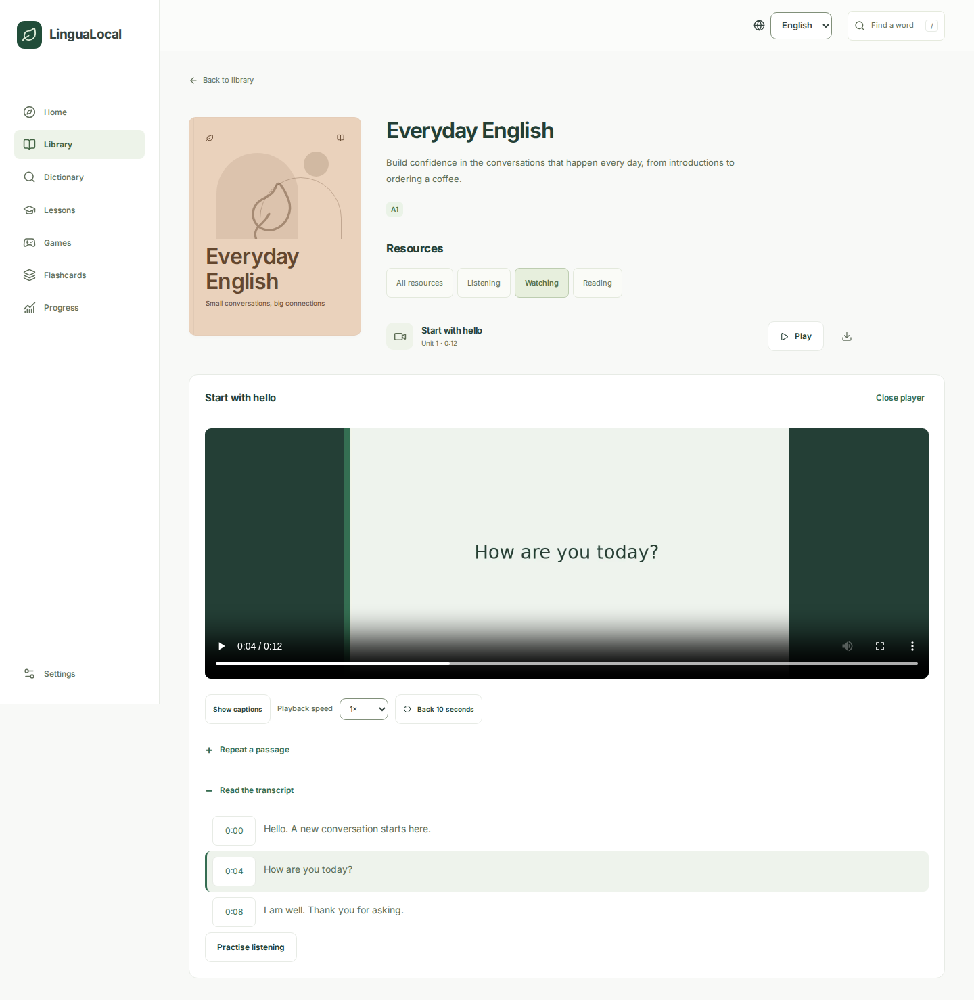

### Dictation from book audio

Open a timed transcript and choose listening practice. Replay short passages, type what you hear, and check individual words. Checked passages count toward private progress, including when leaving early. Capitalization and punctuation do not affect the score.

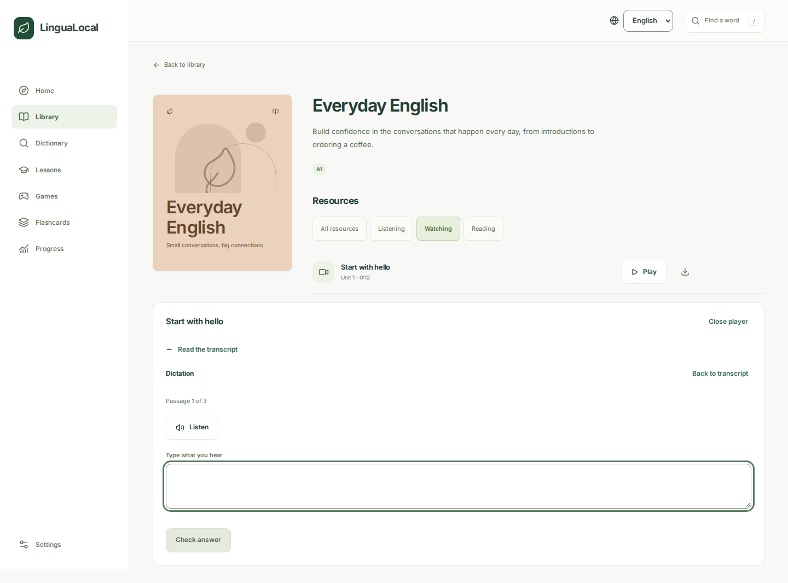

[Answer correction](screenshots/dictation-correction.png) · [Mobile](screenshots/dictation-correction-mobile.png) · [Dark appearance](screenshots/dictation-dark.png) · [Result](screenshots/dictation-complete.png)

### Written and listening practice

Choose spelling, local listening, or gap fill. Use the whole dictionary, a level, or your saved words. Keyboard answers receive immediate feedback. Listening uses an English voice installed on the device.

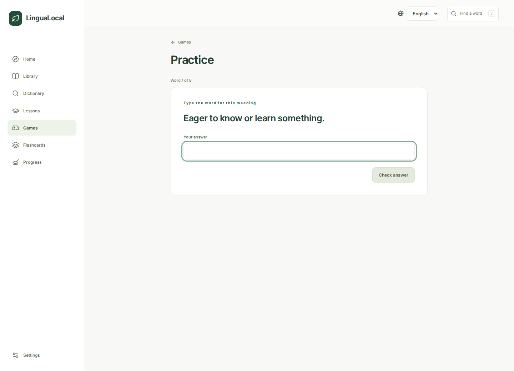

[Answer correction](screenshots/practice-correction.png) · [Mobile](screenshots/practice-correction-mobile.png)

### Dark appearance

Use light or dark colours, or follow the device setting. Preferences survive a reload, while print views use light colours. Books retain their recognisable covers.

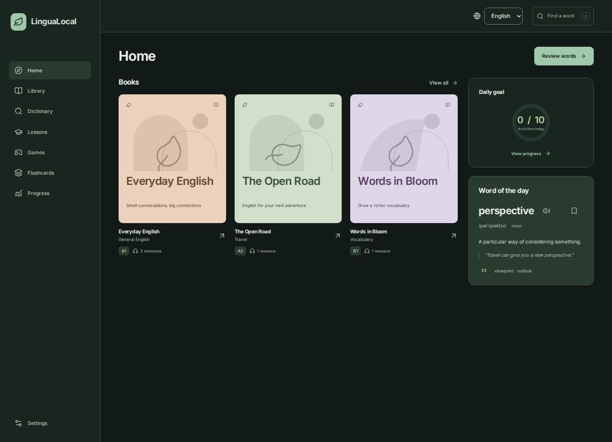

### Lesson vocabulary review

Check an answer, mark the lesson complete, and review its own words without another setup screen. Continue with the next lesson at the same level. Reviews remain in the current browser.

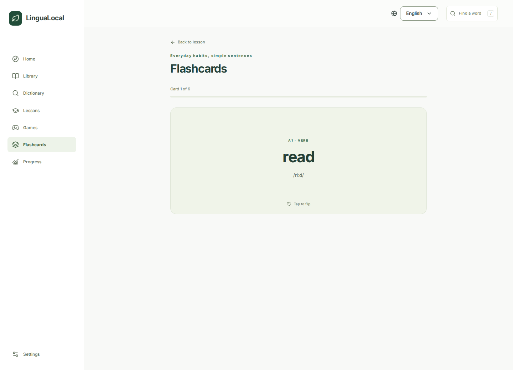

[Completed lesson](screenshots/lesson-completed.png) · [Revealed meaning](screenshots/lesson-review-flipped.png) · [Review result](screenshots/lesson-review-complete.png)
